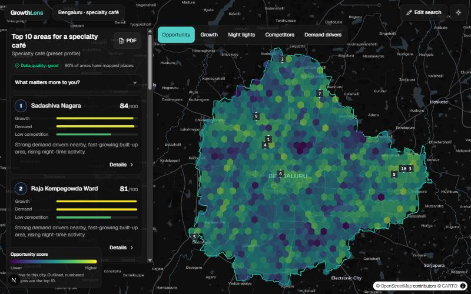
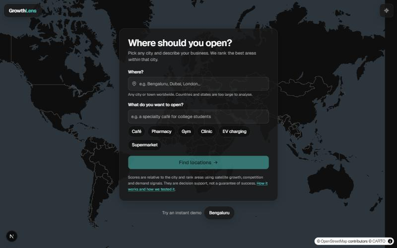
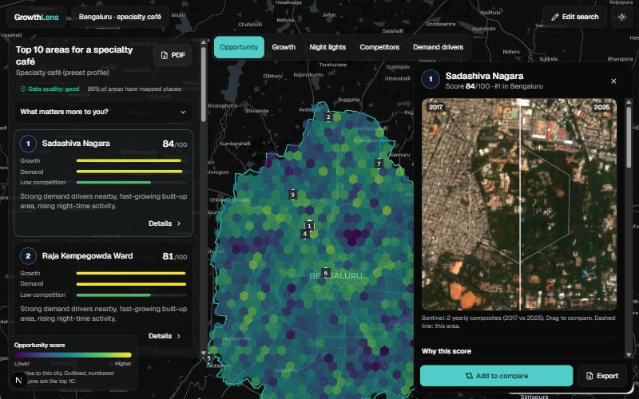
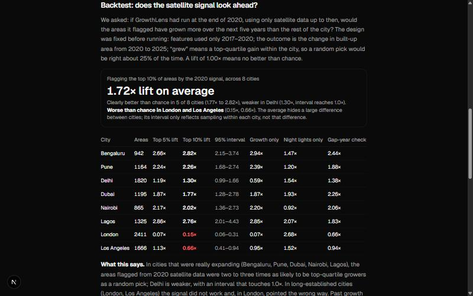
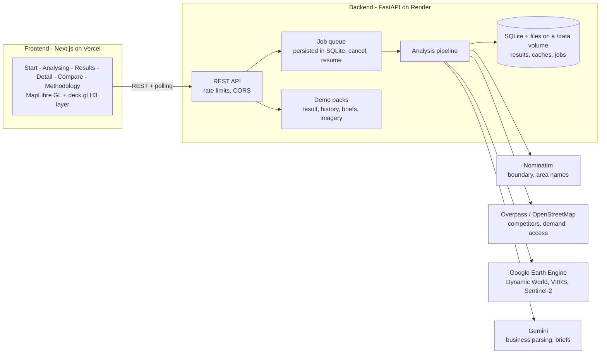
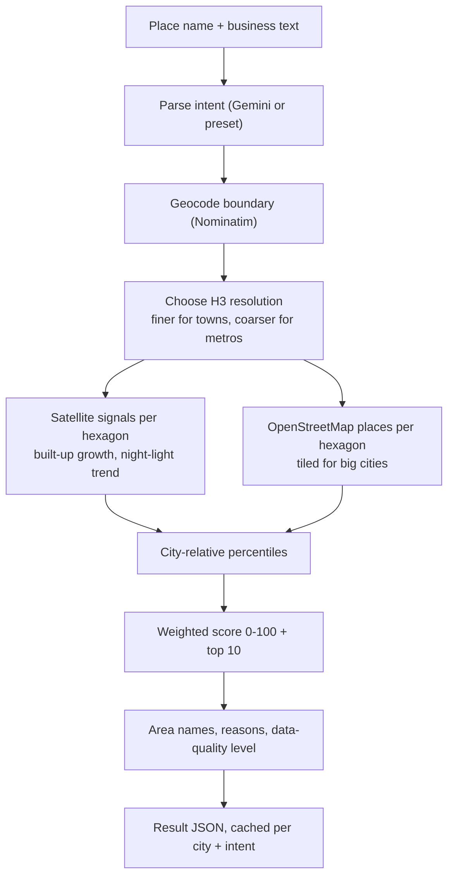

# GrowthLens

**AI site selection from satellite growth data.** Type any city and describe the business you want to open. GrowthLens ranks the best
areas *within* that city on an interactive map, using satellite growth, competition and demand signals, and explains each pick.

> Scores are **relative to the city** and rank areas. They are decision support, not a forecast of revenue or a guarantee of success.



<table>
<tr>
<td width="50%"></td>
<td width="50%"></td>
</tr>
<tr>
<td align="center"><sub>Start: any city worldwide + a plain-language business description</sub></td>
<td align="center"><sub>Detail: 2017 vs 2025 satellite slider, score breakdown, AI brief</sub></td>
</tr>
</table>

## What it does

1. **Understands your business.** Gemini turns "a specialty café for college students" into OpenStreetMap tags and signal weights (with a keyword-preset fallback when the AI is unavailable).
2. **Maps the city** into hexagons (H3, about 0.7 km², finer for small towns, coarser for huge cities).
3. **Measures five signals per hexagon:** built-up growth (Google Dynamic World, 10 m), night-light trend (VIIRS), competitors, demand drivers and transit access (OpenStreetMap).
4. **Scores and ranks** with city-relative percentiles and weights you can change live ("What matters more to you?").
5. **Explains**: an AI-written brief per area (from computed facts only), plain-language score breakdowns, before/after satellite imagery, nearby competitors.

Also: layer toggles, a growth replay (2016 to now), compare view (2-3 areas), PDF report, light/dark mode, works at 360 px, honest data-quality badges, and a [methodology page](frontend/src/app/methodology/page.tsx).

## Does the satellite signal actually look ahead? (backtest)

We froze the clock at the end of **2020**, scored every area using only satellite data up to then, and checked which areas really grew over 2020-2025.
"Grew" means a top-quartile built-up gain within the city, so picking at random is right about 25% of the time (lift 1.00x).

<!-- BACKTEST:START -->
**Headline.** Flagging the top 10% of areas by the 2020 satellite signal, the flagged areas were on average
**1.72x** as likely to become top-quartile growers as a random pick (43% vs 25%), across 8 cities.
**But that average hides a split, and it matters:**

- **Clearly better than chance in 5 cities** (Bengaluru, Pune, Dubai, Nairobi, Lagos; 1.8x to 2.8x), and weaker in Delhi (1.30x, interval touching 1.0).
- **No better than chance, or worse, in long-established cities:** London 0.15x, Los Angeles 0.66x. In London the flagged areas did far *worse* than chance.

| City | Areas | Base rate | Top 5% lift | **Top 10% lift** | Growth-only | Light-only | Room-to-grow | Rank corr. | Gap-year check, top 10% |
|---|---:|---:|---:|---:|---:|---:|---:|---:|---:|
| Bengaluru | 942 | 25% | 2.66 | **2.82** | 2.94 | 1.47 | 1.68 | 0.32 | 2.44 |
| Pune | 1164 | 25% | 2.24 | **2.26** | 2.39 | 1.20 | 0.17 | 0.32 | 1.88 |
| Delhi | 1820 | 25% | 1.19 | **1.30** | 0.59 | 1.54 | 0.15 | 0.08 | 1.38 |
| Dubai | 1195 | 25% | 1.87 | **1.77** | 1.87 | 1.93 | 0.00 | 0.31 | 2.26 |
| Nairobi | 865 | 25% | 2.17 | **2.02** | 2.20 | 0.92 | 0.00 | -0.01 | 2.06 |
| Lagos | 1325 | 25% | 2.86 | **2.76** | 2.85 | 2.07 | 0.00 | 0.68 | 1.83 |
| London | 2411 | 25% | 0.07 | **0.15** | 0.07 | 2.68 | 3.70 | -0.50 | 0.66 |
| Los Angeles | 1666 | 25% | 1.13 | **0.66** | 0.95 | 1.52 | 0.00 | -0.29 | 0.94 |
| **Average (8 cities)** | | 25% | 1.77 | **1.72** | 1.73 | 1.66 | 0.71 | 0.11 | **1.68** |

*Lift = share of flagged areas that grew / share of all areas that grew (1.00x = chance). Rank corr. = Spearman correlation between the 2020 score and the later gain. Growth-only, light-only and room-to-grow are simpler baselines scored the same way.*

**Why the gap-year column exists.** Annual built-up estimates are noisy. If the same year (2020) is used both to score areas and to measure what happened next, noise
in that year pushes the signal and the outcome in opposite directions (regression to the mean), which can make a good signal look backwards. A unit test on pure noise
confirms the artefact is real. So after seeing the first results we added a **sensitivity analysis** with a gap year: score on 2017-2019, measure outcomes
2021-2025, no shared data. The average barely moves (1.68x); London improves
(0.15x to 0.66x) and Los Angeles reaches about chance (0.66x to 0.94x), but London stays below 1.0x. So the artefact explains
part of the failure, not all of it. **The headline above is the design fixed before running; the gap-year column is a labelled check, not a replacement.**

**Product consequence.** The growth signal is informative mainly where a city is visibly expanding. The app now flags the growth signal as unreliable when built-up estimates
*fall* across a whole city on average (London's situation). That check is deliberately simple and does not catch every weak case: Los Angeles would not be flagged.
<!-- BACKTEST:END -->



**How to read this, and what it does not show.**
- It tests the **satellite part** of the score only (growth and night lights). Historical OpenStreetMap data isn't available to us, so competition, demand and access are **not** validated this way.
- "Areas that grew" is not "places where a business succeeds". Growth also continues partly by momentum, which is part of why past growth predicts future growth.
- Neighbouring areas aren't independent, so intervals come from a cluster bootstrap over coarser H3 cells and are approximate.
- Reproduce it: `cd backend && python -m growthlens.backtest_cli --out ../docs/backtest.json` (needs Earth Engine; reruns use the cache). Definition, baselines and leakage tests are in [`backtest.py`](backend/growthlens/backtest.py) and [`test_backtest.py`](backend/tests/test_backtest.py).

## Architecture





| Layer | Choice | Why |
|---|---|---|
| Frontend | Next.js (App Router), TypeScript, Tailwind, shadcn/ui, MapLibre GL, deck.gl | free map stack with no tokens; H3 hexagons render natively |
| Backend | FastAPI, geopandas/shapely, h3, earthengine-api | the geospatial ecosystem is Python |
| Data | Dynamic World, VIIRS, Sentinel-2, OpenStreetMap | free, global, documented |
| AI | Gemini (structured JSON) for intent and briefs | always with a non-AI fallback |
| Storage | SQLite + files (volume) | simple, enough for one instance; Postgres/Supabase is on the roadmap |

## Run it locally

**Prerequisites:** Python 3.13, Node 22+, a Google Cloud project registered for [Earth Engine](https://code.earthengine.google.com/register) (non-commercial), a Gemini API key (optional).

```bash
# backend
cd backend
python -m venv .venv && . .venv/bin/activate        # Windows: .venv\Scripts\activate
pip install -r requirements.txt
cp .env.example .env                                  # set EE_PROJECT and GEMINI_API_KEY
earthengine authenticate                              # one-time browser login
uvicorn growthlens.api:app --port 8000

# frontend (another terminal)
cd frontend
npm install
cp .env.example .env.local                            # NEXT_PUBLIC_API_URL=http://localhost:8000
npm run dev                                           # http://localhost:3000
```

The **Bengaluru demo** works immediately with no keys at all (pre-computed). Everything else needs the live services.

| Variable (backend `.env`) | Purpose |
|---|---|
| `EE_PROJECT` | Earth Engine Cloud project |
| `EE_SERVICE_ACCOUNT_JSON` | service-account key JSON (servers); locally the `earthengine authenticate` login is used |
| `GEMINI_API_KEY`, `LLM_MODEL` | business parsing and briefs; empty key = preset fallback |
| `INTENT_USE_LLM=false` | parse businesses with presets only (briefs still use the AI) |
| `DATA_DIR`, `CORS_ORIGINS`, `TRUST_PROXY` | production settings, see [docs/DEPLOY.md](docs/DEPLOY.md) |

CLI (no UI): `python -m growthlens.cli --city "Pune, Maharashtra, India" --query "24x7 pharmacy"`.

## Demo cities

`backend/demo/` holds pre-computed packs (result, growth history, AI-written briefs, before/after satellite images) that are installed at startup, so a demo
opens in well under a second and never depends on a live data service. **Bengaluru**, **Dubai** and **Pune** show the product at its best (Dubai and Pune use an approximate boundary and say so); **London** is included on purpose:
it shows the data-quality warning for a mature city where the growth signal is unreliable (see the backtest), and the before/after slider falling back to 2018 where
2017 imagery is unusable. Build more with `python -m growthlens.demo_cli --city "..." --slug ...` (needs the live services once).

## Quality

- **Tests:** backend (pytest, all external services mocked), frontend (vitest, including a parity test that re-scores real
  results in TypeScript and matches the Python pipeline), lint and typecheck, all defined in the [CI workflow](.github/workflows/ci.yml) (a clean-room install was verified locally).
- **Resilience:** Overpass mirror rotation with deadlines and stale-cache fallback; tiled queries for big cities; Earth Engine request deadlines;
  persistent, cancellable, resumable background jobs; per-client rate limits; every failure path ends in a plain-language message.
- **Honesty:** data-quality levels (good / check notes / limited), AI text labelled as AI, approximate boundaries flagged, scores never presented as guarantees.

## Deploy

Frontend on Vercel, backend on Render (or Railway): step-by-step in [docs/DEPLOY.md](docs/DEPLOY.md), with a [`render.yaml`](render.yaml) blueprint and a [`Dockerfile`](backend/Dockerfile).

## Limitations and roadmap

- Rankings are relative within one city; no rent, footfall, regulation or cost data.
- OpenStreetMap coverage varies a lot; a zero can mean a real gap or missing data. The app says when coverage looks thin.
- Night lights are coarse (about 500 m) and the weakest signal.
- Only the satellite signals are backtested (see above), in eight cities. **The growth signal did not work in long-established cities (London, Los Angeles)**; the app flags only the clearest case (built-up estimates falling across a whole city).
- Very large areas (provinces, countries) are refused; places with no official boundary get an approximate circle, flagged as such.
- Public Overpass servers are sometimes unavailable; new cities can then fail or load partially (reported clearly). Demo cities are unaffected.
- **Roadmap:** Postgres/Supabase for the cache and jobs (today SQLite + a persistent volume), historical OSM (Overpass attic) to backtest competition and demand, more demo cities, a shared rate-limit store for multi-instance deploys.

## Data sources and terms

Map data © OpenStreetMap contributors (ODbL). Basemap © CARTO. Satellite data via **Google Earth Engine, used under non-commercial terms for this
portfolio project**: Dynamic World (Google/WRI), Sentinel-2 (Copernicus/ESA), VIIRS (NASA/NOAA). Geocoding by Nominatim and place search by Open-Meteo,
both used within their usage policies (cached, rate-limited, identified User-Agent).

---
Built by Sarath (MBA, Operations) as a portfolio project.
